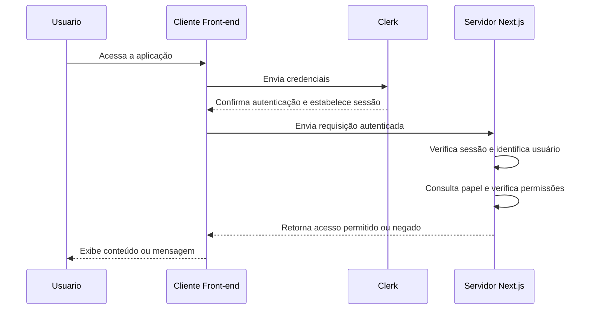
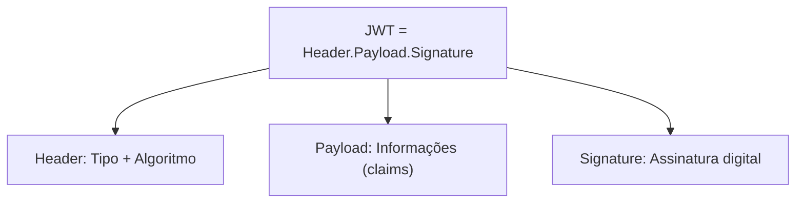

# 🔐 Fluxo de Autenticação e Autorização com Clerk no Next.js

## Executar o projeto

1. Instale as dependências com `npm i`.
2. Copie `.env.local.example` para `.env.local` e preencha as chaves do Clerk.
3. No painel do Clerk, configure o **Public metadata** do usuário com um dos papéis: `aluno`, `professor` ou `diretor`. Exemplo:

   ```json
   { "role": "aluno" }
   ```

4. Execute `npm run dev` e acesse `http://localhost:3000`.

Criar uma conta não atribui um papel automaticamente. Sem um papel válido, o usuário pode entrar, mas precisa solicitar a liberação do acesso.

## 📘 O que é o Clerk?

O **Clerk** é uma plataforma moderna de **autenticação e gerenciamento de usuários** para aplicações web.

Ele oferece recursos completos de login, registro, recuperação de senha, autenticação com provedores externos (como Google e GitHub) e gerenciamento de sessões, além de permitir a implementação de **controle de acesso baseado em papéis (roles)**.

Com o Clerk, o desenvolvedor não precisa implementar manualmente todo o sistema de autenticação, gerenciamento de sessões e validação de tokens. Esses recursos são fornecidos pela plataforma e integrados ao Next.js.

---

## 🧭 Visão Geral do Fluxo

O funcionamento do Clerk pode ser dividido em três etapas principais:

1. **Cliente (Front-end)** — o usuário interage com a interface e realiza o login.
2. **Clerk (Serviço de Autenticação)** — valida a identidade do usuário e gerencia sua sessão.
3. **Servidor (Next.js)** — verifica a autenticação, identifica o usuário, consulta seu papel e decide quais recursos ele pode acessar.

É importante entender a diferença entre:

- **Autenticação:** verifica quem é o usuário.
- **Autorização:** verifica o que esse usuário tem permissão para fazer.

---

## 🧑‍💻 Etapa 1 — Cliente (Front-end)

- O usuário acessa a aplicação e visualiza as telas de login, registro ou recuperação de senha fornecidas pelo Clerk.
- Ao fazer login, o Clerk autentica o usuário e estabelece uma sessão no navegador.
- O navegador mantém as informações necessárias para utilizar essa sessão, normalmente por meio de cookies seguros.
- Nas requisições autenticadas, as credenciais da sessão são enviadas automaticamente conforme a integração configurada.
- O Clerk pode fornecer tokens JWT associados à sessão para identificar o usuário perante o servidor.

Dessa forma, o desenvolvedor não precisa implementar manualmente o armazenamento e o gerenciamento das senhas dos usuários.

---

## 🏢 Etapa 2 — Clerk (Serviço de Autenticação)

O Clerk atua como **provedor de identidade (Identity Provider)**, sendo responsável por confirmar quem é o usuário.

Suas principais responsabilidades são:

- Verificar as credenciais de acesso (login, senha ou autenticação por conta social).
- Criar e gerenciar sessões autenticadas.
- Emitir tokens utilizados para identificar o usuário.
- Disponibilizar informações do usuário para a aplicação.
- Permitir o gerenciamento de metadados e papéis de usuário.

### Informações associadas ao usuário

Dependendo da configuração e do tipo de token utilizado, podem existir informações como:

- ID do usuário.
- E-mail.
- Nome.
- Papel (role), quando configurado.
- Outros dados e metadados.

O Clerk disponibiliza diferentes tipos de metadados:

- **Public Metadata:** informações que podem ser consultadas pelo cliente e pelo servidor, mas alteradas somente pelo servidor.
- **Private Metadata:** informações acessíveis somente pelo servidor.
- **Unsafe Metadata:** informações que também podem ser modificadas pelo cliente, portanto não devem ser utilizadas isoladamente para decisões de autorização.

Os papéis e permissões podem ser armazenados nos metadados e consultados pelo servidor para controlar o acesso aos recursos.

**Importante:** o servidor nunca deve confiar em informações de autorização enviadas diretamente pelo cliente.

---

## ⚙️ Etapa 3 — Servidor (Next.js)

O servidor Next.js é responsável por proteger os recursos da aplicação.

A integração com Clerk
A integração com Clerk permite utilizar recursos como `clerkMiddleware()`, `auth()` e `currentUser()` para trabalhar com a autenticação.

O fluxo pode ser dividido em três responsabilidades:

1. **Identificação:** verifica se existe um usuário autenticado.
2. **Autorização:** verifica se o usuário possui o papel necessário.
3. **Proteção:** permite ou bloqueia o acesso à página, API ou funcionalidade.

Caso o usuário não esteja autenticado ou não possua a permissão necessária, a aplicação pode redirecioná-lo ou retornar uma resposta de acesso negado.

É importante lembrar que o middleware pode ajudar a proteger rotas, mas não substitui as verificações de autorização próximas aos dados e às operações sensíveis.

---

## 🔁 Comunicação entre as Partes

| Etapa | Origem | Destino | Ação |
|---|---|---|---|
| 1 | Usuário | Cliente | Acessa a aplicação e solicita login |
| 2 | Cliente | Clerk | Envia as credenciais de autenticação |
| 3 | Clerk | Cliente | Confirma a autenticação e estabelece a sessão |
| 4 | Cliente | Servidor | Envia requisição com as credenciais da sessão |
| 5 | Servidor | Clerk | Utiliza os recursos de validação da sessão e identificação do usuário |
| 6 | Servidor | Aplicação | Verifica papéis e permissões |
| 7 | Aplicação | Cliente | Retorna o conteúdo ou uma resposta de acesso negado |

---

## 📊 Diagrama do Fluxo



**Observação:** o diagrama representa o fluxo lógico. A validação da sessão pode ocorrer localmente no servidor, utilizando as credenciais e os mecanismos criptográficos do Clerk, sem necessariamente realizar uma consulta externa ao Clerk em cada requisição.

---

## 🧩 Papéis e Autorização (Roles)

O Clerk permite implementar papéis personalizados para os usuários, como `aluno`, `professor` ou `diretor`.

Esses papéis podem ser armazenados nos metadados do usuário e utilizados pelo servidor para controlar as permissões.

Exemplo de hierarquia:

- **Aluno** → pode acessar conteúdo básico.
- **Professor** → pode acessar recursos de aluno e professor.
- **Diretor** → possui acesso às áreas administrativas.

O servidor verifica o papel antes de liberar o acesso.

**Importante:** a hierarquia de permissões é uma regra definida pela aplicação. O Clerk disponibiliza os recursos de autenticação e armazenamento dos dados, mas a lógica de autorização precisa ser implementada pelo desenvolvedor.

### Organização centralizada das permissões

A hierarquia fica em um único lugar:

`src/lib/acesso.js`

`ACESSO` define os papéis autorizados por rota. O nome da rota também é o texto exibido no link.

O arquivo `src/proxy.js` verifica as permissões antes de liberar as rotas. A página inicial usa a mesma configuração para apresentar os links permitidos.

### Rotas do projeto

| URL | Papéis que podem acessar |
|---|---|
| `/` | Todos, com ou sem login |
| `/boletim` | aluno, professor |
| `/turmas` | professor |
| `/turmas/docente` | professor |
| `/turmas/instrutor` | professor |
| `/dashboard` | diretor |

O proxy verifica o primeiro segmento da URL. Por isso, `/turmas/docente` e `/turmas/instrutor` seguem a permissão de `turmas`.

Sem login ou sem permissão, o usuário é redirecionado para `/`. Papéis ausentes ou desconhecidos não recebem acesso às rotas protegidas.

Para adicionar uma área protegida, crie a página e inclua seu primeiro segmento como chave em `ACESSO`, com a lista de papéis autorizados. O link aparece automaticamente para esses papéis.

Uma nova área que não estiver em `ACESSO` será pública. O d
O diretor mantém acesso somente ao dashboard.

### Dados e operações protegidas

Ao adicionar consultas a dados, Server Actions ou Route Handlers, verifique a autenticação e as permissões também nessas operações. Ocultar links não protege os dados.

---

## O que é JWT?

O **JWT (JSON Web Token)** é um formato padronizado de token utilizado para transmitir informações (claims) entre sistemas.

Ele pode ser utilizado para representar informações de autenticação e identificar usuários em aplicações web.

Um JWT é composto por três partes:

1. **Header (Cabeçalho)** — indica o tipo de token e o algoritmo utilizado para gerar sua assinatura.
2. **Payload (Corpo)** — contém as informações (claims), como identificadores e outros dados associados ao usuário.
3. **Signature (Assinatura)** — permite verificar a integridade e a autenticidade do token.

O Clerk utiliza tokens JWT em seus mecanismos de autenticação.

Quando o servidor recebe uma requisição autenticada, ele utiliza os mecanismos de validação do Clerk para verificar a autenticidade e a validade das credenciais recebidas.

- Se forem válidas, o servidor poderá identificar o usuário.
- Se forem inválidas ou expiradas, a autenticação será rejeitada.

**Importante:** um JWT assinado não é necessariamente criptografado. Seu conteúdo pode ser decodificado e lido. A assinatura garante que as informações não foram modificadas indevidamente, mas não esconde seu conteúdo.

Além disso, o uso de JWT não significa que o sistema não possua sessões. O Clerk continua gerenciando as sessões dos usuários.

---

### 🧩 Estrutura de um JWT



**Exemplo de formato:**

`xxxxx.yyyyy.zzzzz`

Cada parte é codificada em Base64URL e separada por um ponto (`.`).

As duas primeiras partes podem ser decodificadas para visualizar seu conteúdo. A terceira parte contém a assinatura utilizada na validação do token.

---

## 🔒 Benefícios do Fluxo Clerk + Next.js

- Autenticação completa com integração simplificada.
- Gerenciamento de sessões e tokens.
- Controle de acesso baseado em papéis e permissões.
- Compatibilidade com login social (Google, GitHub etc.).
- Integração com Server Components e recursos do Next.js.
- Possibilidade de proteger páginas, APIs e operações no servidor.
- Gerenciamento centralizado de usuários.
- Interface de login moderna e personalizável.
- Redução da necessidade de implementar manualmente mecanismos de autenticação.

---

## 🧠 Resumo Simplificado do Processo

### 📌 Conceito fundamental

**Autenticação responde: quem é você?**

**Autorização responde: o que você pode acessar ou fazer?**

O Clerk facilita a autenticação e o gerenciamento de sessões, enquanto o Next.js executa as verificações necessárias para garantir que cada usuário acesse somente os recursos permitidos pela aplicação.